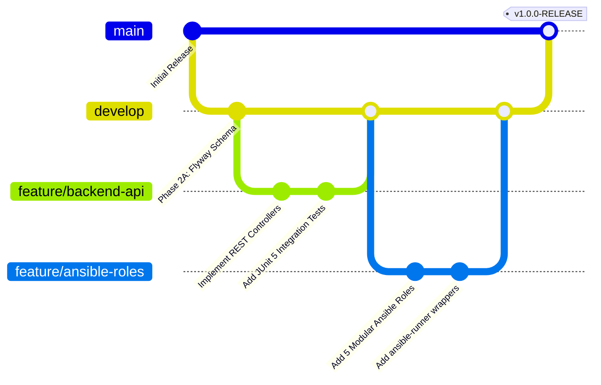
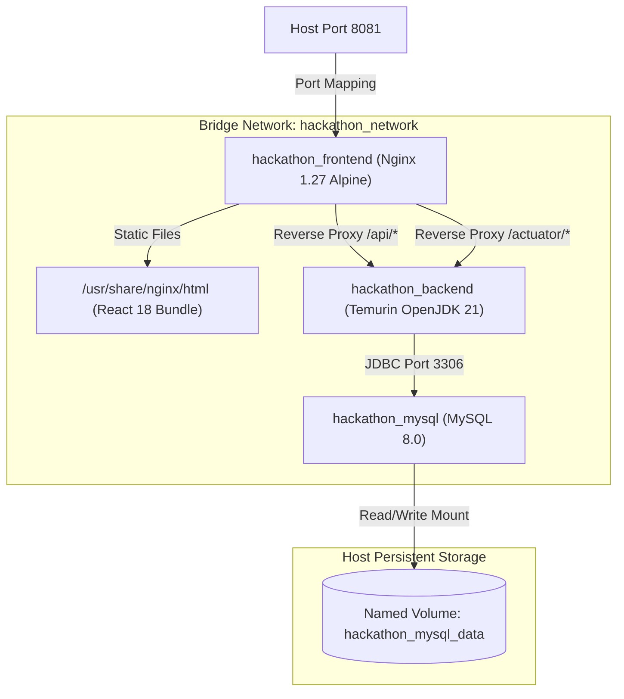
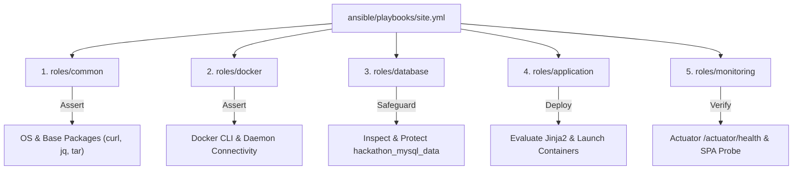

# GRID — Complete DevOps Lifecycle & Engineering Workflow

## 1. Complete DevOps Lifecycle

The GRID engineering lifecycle bridges development, continuous integration, configuration management, automated testing, container orchestration, and runtime telemetry.

```mermaid
flowchart TD
    subgraph "1. Plan & Code"
        A[Git Feature Branch] --> B[Local Unit Tests]
        B --> C[Pull Request Review]
        C --> D[Merge to main branch]
    end

    subgraph "2. Continuous Integration (Jenkins)"
        D --> E[SCM Checkout & Commit Validation]
        E --> F[JDK 21 & Maven Environment Check]
        F --> G[Compile Spring Boot Backend]
        G --> H[Run 44 JUnit 5 & Mockito Tests]
        H --> I[Compile & Bundle React 18 SPA]
        I --> J[Verify Production Bundle dist/index.html]
    end

    subgraph "3. Continuous Delivery & Packaging"
        J --> K[Build Multi-Stage Docker Backend Image]
        K --> L[Build Multi-Stage Docker Frontend Image]
        L --> M[Tag Images: 1.0.0-BUILD_NUMBER & latest]
        M --> N[Validate Image Integrity in Local Daemon]
    end

    subgraph "4. Automated Provisioning (Ansible)"
        N --> O[Run grid-ansible Control Node]
        O --> P[Verify Common OS Dependencies & Scaffolding]
        P --> Q[Assert Persistent Volume Safeguard: hackathon_mysql_data]
        Q --> R[Generate Jinja2 Templates: .env & default.conf]
        R --> S[Deploy Multi-Container Stack via Docker Compose]
    end

    subgraph "5. Quality Assurance & Monitoring"
        S --> T[Probe Spring Boot Actuator /actuator/health]
        T --> U[Execute Headless Selenium Browser Journeys]
        U --> V[Archive Surefire Test Reports]
        V --> W[Report Final Pipeline SUCCESS]
    end
```

---

## 2. Git Branching & Collaboration Workflow

GRID adheres to an enhanced GitHub Flow branching strategy:

### Branching Rules
1. `main`: Protected production branch. All commits must pass the automated Jenkins CI/CD pipeline.
2. `develop`: Active integration branch for feature consolidations.
3. `feature/*`: Dedicated branches for modular feature implementations.

---

## 3. Jenkins CI/CD Pipeline Architecture

The Declarative Jenkins Pipeline (`Jenkinsfile`) manages end-to-end continuous integration and delivery:

| Stage # | Stage Name | Purpose & Verification |
| :--- | :--- | :--- |
| **Stage 1** | **Checkout SCM** | Fetches the targeted branch commit from `https://github.com/chirantan-t/hackrlist.git`. |
| **Stage 2** | **Environment Verification** | Verifies Java 21, Maven 3.9+, Node 22, npm 10, Docker 29, and Docker Compose. |
| **Stage 3** | **Backend Build** | Packages Spring Boot JAR (`mvn clean package -DskipTests`). |
| **Stage 4** | **Backend Unit Testing** | Executes 44 JUnit 5 & MockMvc tests; publishes test reports to Jenkins dashboard. |
| **Stage 5** | **Frontend Build** | Compiles React assets using Vite production minification. |
| **Stage 6** | **Frontend Testing** | Asserts production bundle existence (`dist/index.html`). |
| **Stage 7** | **Docker Image Packaging** | Builds tagged backend and frontend container images (`1.0.0-${BUILD_NUMBER}`). |
| **Stage 8** | **Docker Image Validation** | Validates container images in local registry. |
| **Stage 9** | **Ansible Automated Provisioning** | Executes `ansible-runner.bat` with `site.yml` across 5 idempotent roles. |
| **Stage 10**| **Health Verification** | Probes `/actuator/health` endpoint with retry loop until composite status is `UP`. |
| **Stage 11**| **Post-Build Reporting** | Publishes JUnit test artifacts, captures execution metrics, and sets final build status. |

---

## 4. Docker Container Architecture

GRID implements a 3-tier isolated microservices stack connected via a custom bridge network:

### Docker Compose Specifications
* **Network Isolation:** Dedicated bridge network `hackathon_network`.
* **Database Volume Safeguard:** Explicit named volume `hackathon_mysql_data`.
* **Health Checks:**
  * `hackathon_mysql`: `mysqladmin ping -h localhost -u root -p$MYSQL_ROOT_PASSWORD` (10s interval).
  * `hackathon_backend`: `curl -f http://localhost:8080/actuator/health` (15s interval, depends on `db: service_healthy`).
  * `hackathon_frontend`: `wget -qO- http://127.0.0.1:80/` (15s interval, depends on `backend: service_healthy`).

---

## 5. Ansible Configuration Management

Ansible guarantees idempotent provisioning and environment alignment across 5 modular roles:

### Idempotency Guarantee
* **First Run:** Provisions missing dependencies, generates configuration templates, starts containers (`changed > 0`).
* **Second Run:** Inspects existing resources, detects aligned states, skips unnecessary operations (`changed = 0`).
* **Check Mode Support:** Validated with `ansible-playbook --check` for dry-run verification.
