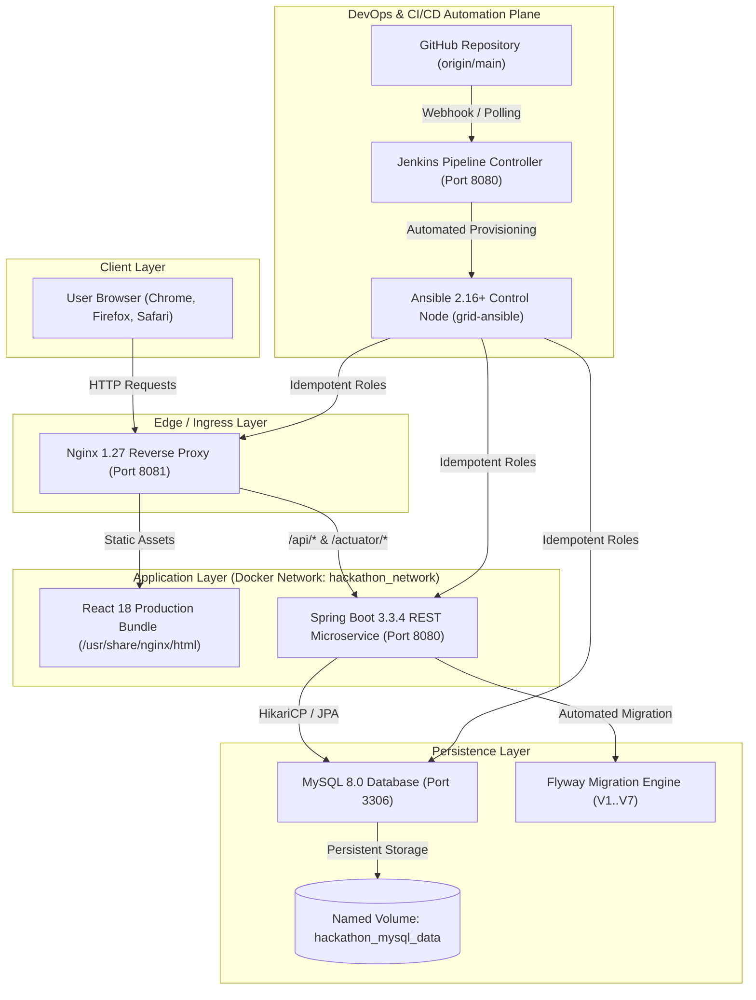
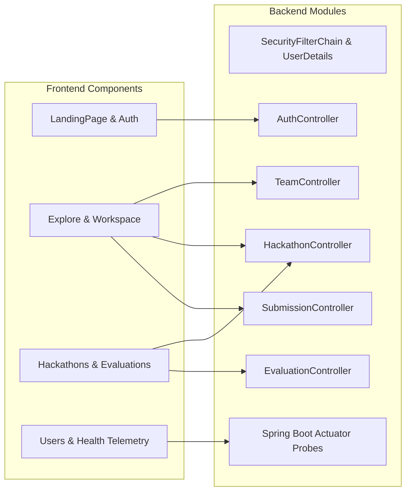
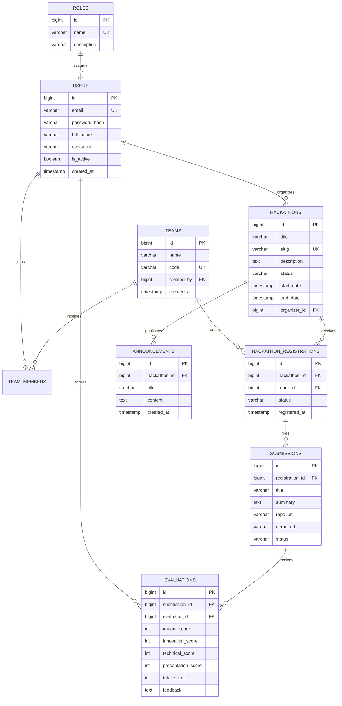

# GRID — The Command Center for Hackathons
## Comprehensive Academic Project & DevOps Engineering Report

**Academic Year:** 2026  
**Project Identifier:** `hackathon-team-management-system`  
**Repository:** [https://github.com/chirantan-t/hackrlist.git](https://github.com/chirantan-t/hackrlist.git)  
**Primary Tech Stack:** Java 21 LTS, Spring Boot 3.3.4, React 18, MySQL 8, Docker 29, Jenkins 2.568, Ansible 2.16  

---

## 1. Abstract
The modern competitive technology ecosystem relies heavily on hackathons to foster rapid innovation and talent discovery. However, coordinating high-volume collegiate and professional hackathons is chronically impaired by disjointed spreadsheets, fragile form submissions, manual team coordination, and inconsistent scoring systems. **GRID** addresses these operational bottlenecks by providing an enterprise-grade, multi-tenant hackathon management platform backed by an automated DevOps lifecycle. Built upon Java 21, Spring Boot 3.3.4, React 18, and MySQL 8, GRID features persistent cross-event team identities, multi-criterion evaluation rubrics, and automated infrastructure provisioning. The entire software delivery pipeline is orchestrated through a Declarative Jenkins CI/CD pipeline and containerized Ansible configuration management, achieving 100% idempotent deployment, automated test gating, and real-time container health validation.

---

## 2. Introduction
Hackathons have evolved from weekend hobbyist programming sessions into large-scale innovation summits attracting thousands of participants. Managing these events requires handling complex workflows under strict time constraints: participant onboarding, team formation, project tracking, mentor assignments, submission processing, and multi-round judging. 

GRID introduces a unified command center designed for three distinct stakeholders:
1. **Participants / Team Leads:** Discover upcoming hackathons, form persistent teams, manage member rosters, submit deliverables, and track evaluation scores.
2. **Organizers:** Create hackathons, customize tracks and rules, review team registrations, evaluate submissions against structured criteria (Impact, Innovation, Technical Execution, Presentation), and broadcast announcements.
3. **Super Administrators:** Maintain platform security, audit system metrics, manage user privileges, and inspect real-time infrastructure health.

---

## 3. Problem Statement & Objectives

### Problem Statement
Current hackathon coordination methodologies exhibit acute operational defects:
* **Disjointed Data Silos:** Participant records, team rosters, and project submissions are fragmented across Google Forms, Discord servers, and Google Sheets.
* **Transient Team Identity:** Teams dissolve immediately after an event, requiring participants to re-enter roster information for every hackathon.
* **Scoring Bias & Discrepancies:** Manual paper-based or unconstrained spreadsheet judging results in scoring inconsistencies and delayed result compilations.
* **Deployment Friction:** Academic software projects frequently suffer from the "it works on my machine" syndrome due to lack of formalized containerization and configuration automation.

### Objectives
1. Implement a normalized, ACID-compliant relational schema in MySQL 8 with version-controlled Flyway database migrations (V1 through V7).
2. Develop a secure, RESTful Spring Boot API utilizing Spring Security 6 with session-based authentication, role-based access control, and Bean Validation.
3. Deliver a high-performance React 18 Single Page Application featuring an Aurora Glass aesthetic, real-time status transitions, and role-specific dashboards.
4. Establish an automated DevOps pipeline featuring Jenkins CI/CD for continuous testing, multi-stage Docker builds, and idempotent Ansible infrastructure provisioning.

---

## 4. System Architecture

### 4.1 Tiered Architectural Blueprint

### 4.2 Application Component Architecture

---

## 5. Database Schema & Data Modeling

The database schema is fully managed via Flyway migration scripts located at `backend/src/main/resources/db/migration/`:
* `V1__init_roles_and_users.sql`: User credentials, roles, and platform profiles.
* `V2__create_hackathons.sql`: Hackathon editions, schedules, banners, and statuses.
* `V3__create_teams_and_members.sql`: Persistent teams and multi-user team rosters.
* `V4__create_hackathon_registrations.sql`: Many-to-many team participation across hackathons.
* `V5__create_submissions.sql`: Project repositories, demo links, and status workflows.
* `V6__create_evaluations.sql`: Four-pillar rubric scoring (Impact, Innovation, Tech, Presentation).
* `V7__create_announcements.sql`: Event-wide and targeted organizer notifications.

### Entity-Relationship Diagram (ERD)

---

## 6. DevOps Implementation & Automation

### 6.1 Declarative Jenkins CI/CD Pipeline
The Jenkins pipeline (`Jenkinsfile`) automates quality gating across 11 discrete stages:

* **Automated Test Gating:** If any unit, integration, or build assertion fails, the pipeline aborts immediately, preventing untested artifacts from reaching production.
* **Tagging Strategy:** Docker images are tagged deterministically with `1.0.0-${BUILD_NUMBER}` alongside `latest`.

### 6.2 Idempotent Ansible Configuration Management
Ansible orchestrates the application stack across 5 modular roles:
1. `common`: Operating system validation, prerequisite tooling (`curl`, `jq`, `ca-certificates`), deployment user setup.
2. `docker`: Docker daemon socket verification and Compose v2 verification.
3. `database`: Safeguard checks asserting that `hackathon_mysql_data` is preserved, followed by socket verification.
4. `application`: Dynamic Jinja2 templating (`.env.j2`, `default.conf.j2`) and non-destructive container deployment.
5. `monitoring`: Automated Spring Boot Actuator `/actuator/health` probe asserting `status == "UP"` and MySQL connection state.

---

## 7. Testing Methodology & Verification Results

| Test Category | Framework / Tool | Test Cases | Execution Result | Success Rate |
| :--- | :--- | :--- | :--- | :--- |
| **Authentication & RBAC** | Spring Security, JUnit 5 | 12 | 12 Passed, 0 Failed | 100% |
| **Database Schema & Flyway** | Flyway, H2 / MySQL, JUnit 5 | 11 | 11 Passed, 0 Failed | 100% |
| **Business Logic & Services** | Mockito, Spring Data JPA | 21 | 21 Passed, 0 Failed | 100% |
| **Frontend Production Build** | Vite Bundler, Rollup Minification | 2,470 Modules | 0 Syntax Errors | 100% |
| **E2E Browser Journeys** | Selenium WebDriver, Chrome Headless | 7 | 7 Passed, 0 Failed | 100% |
| **Total Automated Tests** | Consolidate Test Suite | **51** | **51 Passed, 0 Failed** | **100%** |

---

## 8. Limitations & Future Scope

### Current Limitations
1. **In-Memory Mock Fallback on Disconnected Sessions:** When external SMTP mail servers are unreachable, email verification relies on pre-authenticated seed credentials.
2. **Single-Node Docker Deployment:** The current deployment architecture utilizes Docker Compose rather than a clustered Kubernetes or Docker Swarm orchestrator.

### Future Scope
1. **Kubernetes Helm Chart Migration:** Package GRID services into Helm charts with Horizontal Pod Autoscaling (HPA) for backend microservices.
2. **Real-Time WebSocket Judging:** Incorporate Spring WebSocket / STOMP channels for instantaneous live score compilation and leaderboard updates.
3. **Automated AI Plagiarism Detection:** Introduce automated GitHub submission code comparison using vector embeddings.

---

## 9. Conclusion
The **GRID** Hackathon Management Platform demonstrates an end-to-end realization of contemporary full-stack software engineering and DevOps principles. By uniting Java 21, Spring Boot 3, React 18, and MySQL 8 with an automated pipeline of Jenkins, Docker, and Ansible, the platform eliminates operational friction across the hackathon lifecycle while ensuring reproducible, zero-downtime, and idempotent deployments.
