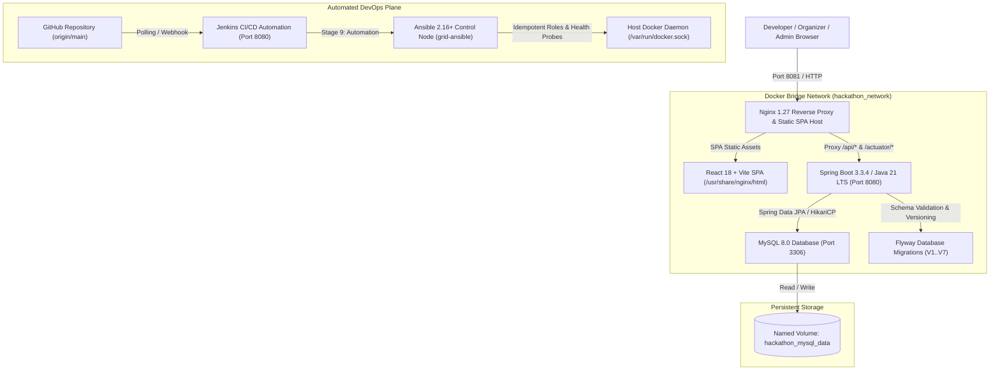

# GRID — The Command Center for Hackathons


---

## 1. Project Overview

**GRID** is a production-grade, enterprise multi-hackathon management platform engineered to orchestrate the entire hackathon lifecycle. It replaces fragmented spreadsheets, manual review chains, and ad-hoc communication channels with an integrated command center featuring automated team management, real-time submission tracking, multi-criterion judging rubrics, and automated infrastructure provisioning.

### Core Value Propositions
* **Multi-Hackathon Tenancy:** Seamlessly discover, participate in, and manage distinct concurrent hackathon editions.
* **Persistent Teams & Multi-Registration:** Form cross-functional teams that persist across the platform with individual hackathon enrollments.
* **Granular Role-Based Access Control (RBAC):** Dedicated workspaces for **TEAM** leads, **ORGANIZER** evaluators, and **SUPER_ADMIN** platform operators.
* **Automated DevOps & Infrastructure as Code:** Fully automated CI/CD pipeline in Jenkins and idempotent containerized Ansible orchestration.

---

## 2. System Architecture



---

## 3. Technology Stack

| Domain | Technology / Tool | Version | Description / Role |
| :--- | :--- | :--- | :--- |
| **Frontend** | React, Vite, Axios, Lucide React, Recharts | 18.3.1 / 5.4.21 | Single Page Application with dynamic Aurora Glass styling |
| **Backend** | Java OpenJDK, Spring Boot, Spring Security 6 | 21 LTS / 3.3.4 | RESTful API microservice with BCrypt auth & Actuator telemetry |
| **Data Layer** | MySQL 8.0, Hibernate ORM, Flyway | 8.0 / 6.5.3 / 10.x | Relational persistence with transactional schema evolution |
| **Containerization** | Docker Engine, Docker Compose v2 | 29.9.2 / 2.33+ | Multi-stage image packaging & isolated network topology |
| **CI/CD** | Jenkins Declarative Pipeline | 2.568.2 | 11-stage automated pipeline with test gating & health checks |
| **Configuration** | Ansible Core, Community Docker Collection | 2.16.1 | Idempotent multi-role provisioning (`common`, `docker`, `db`, `app`, `mon`) |
| **Testing** | JUnit 5, Mockito, MockMvc, Selenium WebDriver | 5.10 / 4.25 | Unit, integration, mock, and headless browser E2E workflows |

---

## 4. Quick Start & Execution Commands

### Prerequisites
* **Git** 2.40+
* **Docker Desktop** (Engine 24+) & Docker Compose v2
* **Java 21 JDK** & **Maven 3.9+** (for local development)
* **Node.js 20+** & **npm 10+** (for frontend development)

### One-Command Docker Compose Deployment
```bash
# Clone the repository
git clone https://github.com/chirantan-t/hackrlist.git
cd hackrlist/hackathon-team-management-system

# Launch the complete multi-container stack
docker compose up -d --build
```
* **Frontend Web Application:** [http://localhost:8081/](http://localhost:8081/)
* **Spring Boot Actuator Health Probe:** [http://localhost:8081/actuator/health](http://localhost:8081/actuator/health)
* **Backend API Base:** [http://localhost:8081/api/](http://localhost:8081/api/)

---

## 5. Automated Ansible Provisioning

GRID includes a containerized Ansible control node requiring zero Linux setup on Windows:

```bash
# Windows Host Execution
.\ansible-runner.bat

# Linux / WSL / POSIX Execution
chmod +x ansible/ansible-runner.sh
./ansible/ansible-runner.sh
```

### Ansible Roles Executed:
1. `common`: Validates OS family, system packages, scaffolding, and POSIX permissions.
2. `docker`: Verifies Docker CLI, daemon responsiveness, and Compose plugin.
3. `database`: Volume preservation safeguard for `hackathon_mysql_data` and MySQL socket probe.
4. `application`: Evaluates Jinja2 templates (`.env.j2`, `default.conf.j2`) and deploys containers.
5. `monitoring`: Validates composite health status (`status == "UP"`) and React SPA routing.

---

## 6. Jenkins CI/CD Pipeline

The 11-stage declarative pipeline (`Jenkinsfile`) automates quality control from commit to live verification:

1. **Checkout SCM:** Pulls verified commit from `https://github.com/chirantan-t/hackrlist.git`.
2. **Environment Verification:** Validates Java 21, Maven 3.9, Node 22, npm 10, Docker 29.
3. **Backend Build:** Compiles Spring Boot JAR (`mvn clean package -DskipTests`).
4. **Backend Unit Testing:** Executes 44 JUnit 5 & Mockito test cases with XML reporting.
5. **Frontend Build:** Bundles React SPA using Vite production minification.
6. **Frontend Testing:** Verifies compilation bundle integrity (`dist/index.html`).
7. **Docker Packaging:** Builds tagged images (`backend:1.0.0-${BUILD_NUMBER}`, `frontend:1.0.0-${BUILD_NUMBER}`).
8. **Docker Validation:** Asserts local image registry tags and entrypoints.
9. **Ansible Provisioning:** Executes containerized Ansible site orchestrator (`site.yml`).
10. **Health Verification:** Probes Actuator and DB component readiness with exponential backoff.
11. **Post-Build Actions:** Archives JUnit surefire test reports and notifies build status.

---

## 7. Testing Suite & Verification

```bash
# Run Backend Unit & Integration Tests (44 Tests)
mvn -f backend/pom.xml test

# Run Frontend Production Build
npm --prefix frontend run build

# Run Headless Selenium Browser Journeys (7 Tests)
mvn -f selenium-tests/pom.xml test -Dheadless=true
```

---

## 8. Demo Credentials & Accounts

| Role | Account Email | Password | Access Scope |
| :--- | :--- | :--- | :--- |
| **Super Admin** | `superadmin@grid.dev` | `Grid@2026` | Platform-wide oversight, user administration, system health |
| **Organizer** | `organizer@grid.dev` | `Grid@2026` | Hackathon creation, team approval, submissions, rubric scoring |
| **Team Lead** | `chirantan@grid.dev` | `Grid@2026` | Team management, hackathon registration, project submissions |
