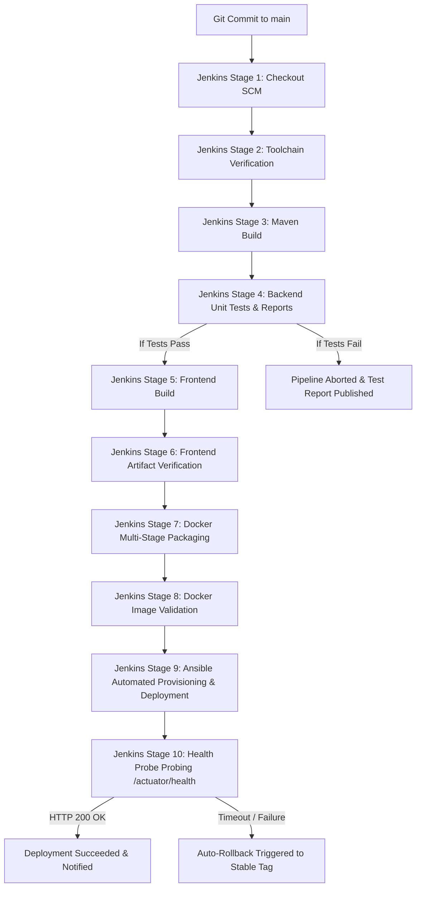

# CI/CD Pipeline & Automation Workflow

**Project:** GRID — The Command Center for Hackathons  
**Pipeline Orchestrator:** Jenkins Declarative Pipeline (Windows Service / Dockerized Agent)  
**Configuration Management:** Ansible 2.16+ (Containerized Control Node `grid-ansible:latest`)  

---

## 1. Overview
The continuous integration and continuous deployment (CI/CD) engine orchestrates the transformation of developer commits into tested, containerized releases deployed behind an Nginx reverse proxy using Ansible automated configuration management.

---

## 2. Pipeline Stages in Detail

### Stage 1: Checkout Source (SCM)
* Clones Git repository using Jenkins SCM from `https://github.com/chirantan-t/hackrlist.git`.
* Resolves branch (`main`), commit hash, and checkout metadata.

### Stage 2: Environment Verification
* Verifies presence of JDK 21 (`java -version`), Maven 3.9+ (`mvn -version`), Node.js 22 (`node -v`), npm (`npm -v`), and Docker Engine daemon connectivity.

### Stage 3: Backend Build
* Runs `mvn clean package -DskipTests` inside `backend/`.
* Compiles the Spring Boot 3.x backend into an executable fat JAR in `backend/target/`.

### Stage 4: Backend Unit Testing & Reporting
* Runs `mvn test` inside `backend/`.
* Executes 44 JUnit 5 unit and MockMvc integration tests using an isolated in-memory H2 database.
* Publishes test results via Jenkins `junit` step to `backend/target/surefire-reports/*.xml`.

### Stage 5: Frontend Compilation
* Runs `npm ci` and `npm run build` inside `frontend/`.
* Bundles static React JavaScript, CSS, and HTML assets into `frontend/dist/`.

### Stage 6: Frontend Build Artifact Validation
* Validates static production bundle output in `frontend/dist/index.html`.

### Stage 7: Multi-Stage Docker Image Packaging
* Generates minimal, production-ready container images with non-root security.
* Builds `hackathon-team-management-backend:${RELEASE_VERSION}-${BUILD_NUMBER}`.
* Builds `hackathon-team-management-frontend:${RELEASE_VERSION}-${BUILD_NUMBER}`.
* Tags latest release metadata.

### Stage 8: Docker Image Validation & Inspection
* Inspects generated images, verified layers, tags, and container sizes via Docker CLI.

### Stage 9: Ansible Automated Provisioning & Deployment
* Triggers containerized Ansible Control Node (`grid-ansible:latest`) executing `ansible/playbooks/site.yml`.
* Ingests target inventory (`ansible/inventory/${DEPLOY_ENV}.ini`).
* Executes 5 modular roles in sequence:
  1. `common`: OS family validation, baseline system dependencies, and deployment user paths.
  2. `docker`: Docker Engine daemon connectivity and Docker Compose CLI validation.
  3. `database`: MySQL 8 volume inspection (`hackathon_mysql_data`), volume preservation safeguard, and database readiness.
  4. `application`: Jinja2 template rendering (`.env`, `default.conf`), Docker Compose multi-container stack deployment (`docker compose up -d`).
  5. `monitoring`: Integrated Actuator and frontend HTTP health checks with detailed reporting.
* Guarantees 100% idempotent configuration management without data loss or unnecessary service disruption.

### Stage 10: Post-Deployment Health Verification
* Probes `http://localhost:${PORT}/actuator/health` every 3 seconds for up to 12 attempts.
* Asserts overall system status `UP` and database connectivity `components.db.status == "UP"`.
* Verifies frontend SPA route accessibility (`http://localhost:${PORT}/`) with HTTP 200 OK.

### Stage 11: Post-Build Reporting & Artifact Archival
* Publishes JUnit test results from `backend/target/surefire-reports/*.xml`.
* Archives executable Spring Boot JAR artifacts under `backend/target/*.jar`.
* Emits final deployment summary banner and version metadata.
